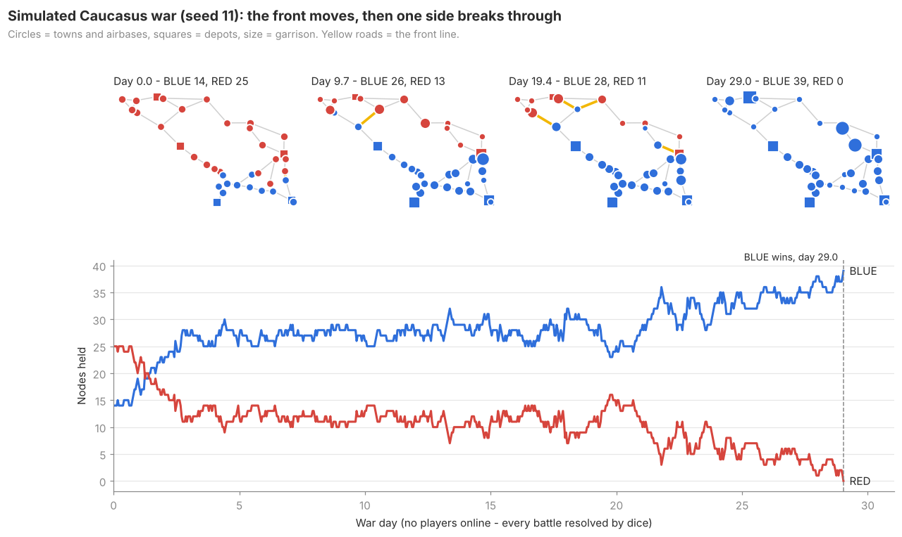
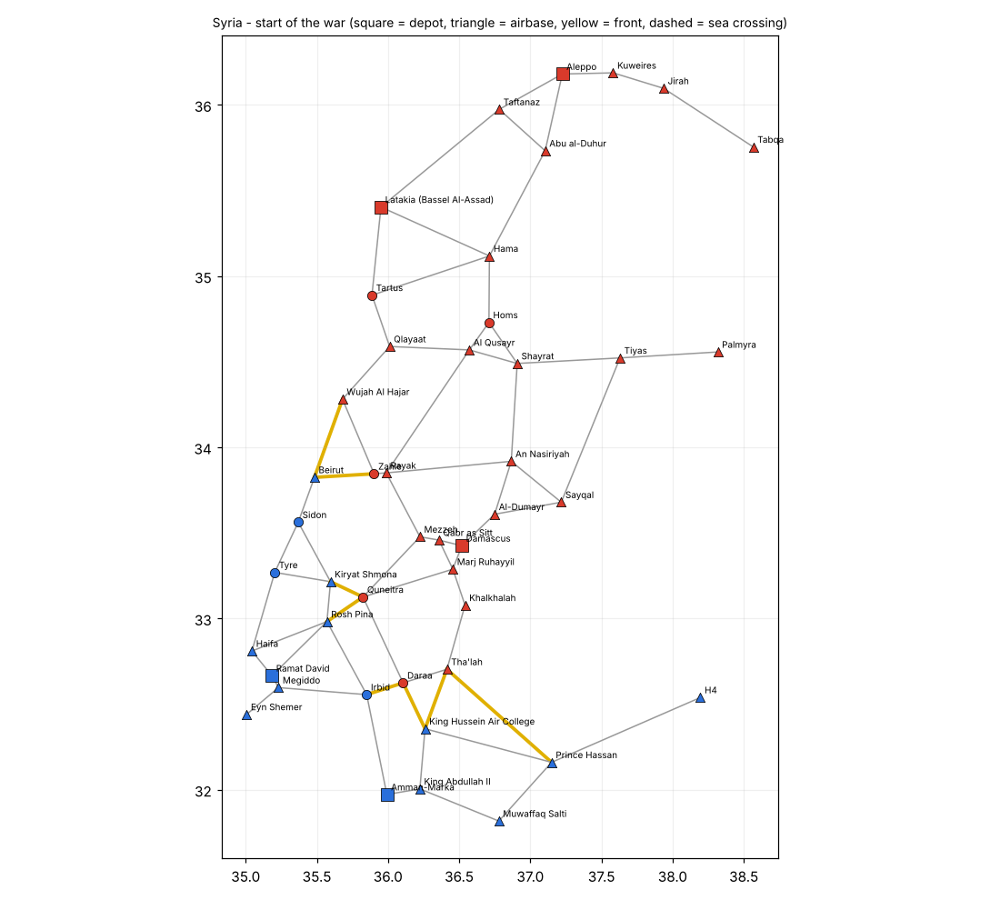
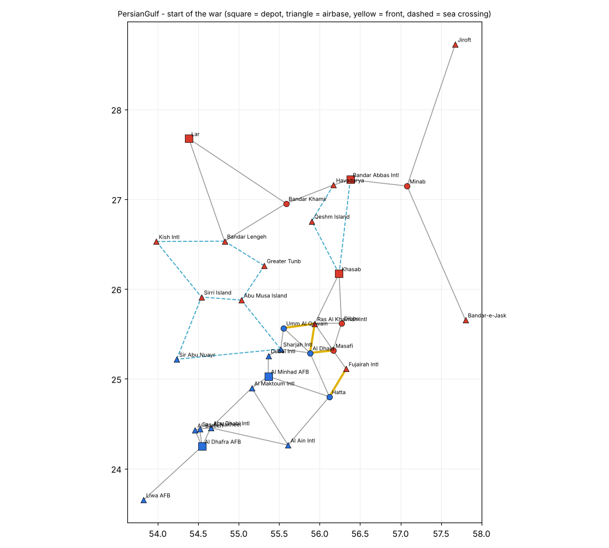
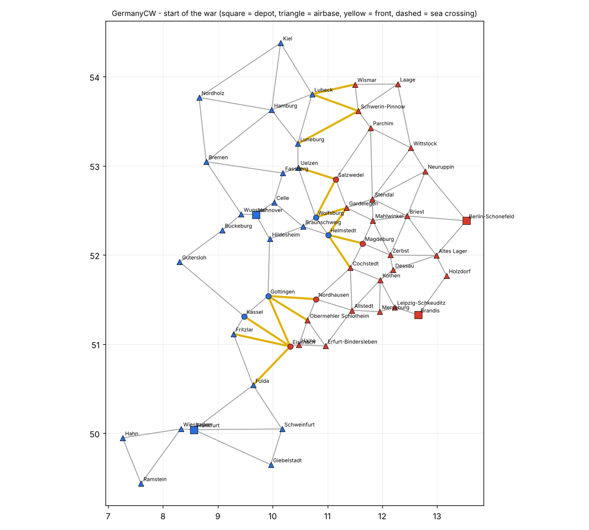

# Danica Dynamic Campaign

A perpetual, persistent dynamic campaign for DCS World. One Lua engine runs inside a 24/7 server
mission, the war keeps going whether anyone is online or not, and when one side loses its last
base the server moves on to the next map in the rotation.

**Status: v0.26 — all four maps, unattended rotation, and a lot of war on top.** Ground forces hold
nodes, mass for assaults and capture bases. Every base runs on supply that trucks, transport aircraft,
helicopters and **supply ships** carry forward. Each side has a **mission board** of 33 mission types —
CAS, BAI, strike, SEAD/DEAD, CAP, escort, convoy escort, recon, CSAR, logistics, FARPs, anti-ship, SCUD
hunts, amphibious landings and more — and every mission writes its effect into the war. Several pilots can
**fly one mission together**. AI fighters, strike packages, tankers, AWACS and carrier air wings fly for
both sides, and **pilot records** follow players across wars and maps. **Territory and the front line**
are drawn on the F10 map, and **fog of war** means each side only sees the enemy it has detected.
**Carriers** (Stennis, Tarawa, Kuznetsov) sail on every map, **weather drifts** over hours, **night**
battles are lit by flares, and every mission carries **kneeboard pages** and **DTC cartridges**. The war
runs on **Caucasus → Syria → Persian Gulf → Cold War Germany**: when one side wins, the next map loads by
itself. Ready-to-fly missions are generated for all four.



*A simulated war with nobody online. Players near a front fight it as real DCS units instead.*

---

## Quick start

**Only access to the missions folder and the server's web UI** (a hosted server)? That works:

1. Upload the four `dist/DCC_*.miz` files.
2. In the server UI, put them in the mission list in this order: Caucasus, Syria, PersianGulf,
   GermanyCW, and switch on looping the list.
3. Start the server. Each war runs for **24 hours** (or until you stop the server); when it is won —
   by conquest or on the clock — the mission ends after two minutes and the server loads the next map.

Without file access the war **cannot be saved**: stopping the server starts that map's war over, and pilot
records last one session. Players are told so at the start. If the host ever enables `io`/`lfs` (step 1
below), saving, the 7-day war clock, persistent pilots and the companion tools switch on by themselves —
nothing to change in the missions.

**Full access to the server PC:**

1. **Server: allow saving** — see [step 1](#1-allow-the-campaign-to-save) below.
2. **Copy the four missions** `dist/DCC_*.miz` to `Saved Games\DCS\Missions\DCC\` and put
   `DCC_Caucasus.miz` in the server's mission list.
3. **Install the rotation hook**: copy `hooks/DCC_rotation_hook.lua` to
   `Saved Games\DCS\Scripts\Hooks\`, and untick *Pause without clients* in the server settings.
4. **Start it as a multiplayer server** (also locally for testing: *Multiplayer → New server*).
   Pick a side and an aircraft at any airbase your side owns.
5. **Optional — web map and Discord:** copy the `server/` folder to the server PC, copy
   `dcc_companion.example.json` to `dcc_companion.json`, fill in your `DCC` folder and Discord
   webhook, and run `start_companion.bat`. See [Web map and Discord](#web-map-and-discord).

That's it — the mission already contains the engine, every airbase, the player aircraft and
the AI aircraft templates.

---

## Flying missions

In the cockpit: **F10 → Other → Missions**:

| Menu | What it does |
| --- | --- |
| **Join a flight** | Missions other pilots of your side are flying right now (any distance) — one click and you are on it |
| **Mission board** | One submenu per mission type your aircraft can fly, 9 per page (*More missions* for the rest) |
| **My mission** | Brief again / abandon |
| **Pilot records** | Your record, the leaderboard, the squadron leaderboard |

No F10 level ever holds more than 10 items (DCS's own paging is unreliable). Taking a mission gives a
briefing — target in degrees/decimal minutes, degrees/minutes/seconds and MGRS, **target elevation**,
bearing and range from you, what success does — and a mark on your F10 map. Every message stays on
screen at least 10 s.

**Flying together.** Any number of pilots can take the same mission. The board shows who is on it
(`SEAD: air defence at Sukhumi [2: Anna, Bo]`), the flight is told when someone joins or leaves, the
briefing lists the flight, and when it succeeds **everyone** gets the mission points, plus a **+5 team
bonus** with 2 or more pilots.

**Local missions for helicopters and slow aircraft.** Helicopters see only missions within **60 nm** of
where they spawned, slow movers (A-10, Su-25, trainers, warbirds) within **120 nm**, nearest first with
the distance shown. The campaign also **creates** missions near them — supply runs, convoy escort, FARP
building, MEDEVAC, prisoners — the moment they spawn, so a rear base always has work.

| Mission | Who | Target | Success when | Effect in the war |
| --- | --- | --- | --- | --- |
| **CAS** | A2G | A base under attack (ours or theirs) | The battle goes your side's way | Who holds the base; every kill is permanent |
| **BAI** | A2G | Enemy convoy or column on a road | It is destroyed | Its cargo or platoons never arrive |
| **STRIKE** | A2G | Fuel, ammo and warehouse buildings at an enemy depot/airbase | A building is destroyed | Each one burns 25 SU and cuts the base's output (all gone = 30 %); one rebuilt every 3 h |
| **SEAD/DEAD** | SEAD | Enemy SAM site (Hawk / SA-11) | Radar or whole site killed | Radar: site offline ~2 h. Radar + launchers: destroyed, rebuilt in ~6 h for 60 SU |
| **EWR** | A2G | Enemy early-warning radar | It is destroyed | That side loses its long-range air picture there (6 h, 40 SU) |
| **CAP** | A2A | Your main-effort area | 20 min on station, or an air kill there | 1 h of air superiority: enemy AI attack sorties stay away |
| **ESCORT** | A2A (supply helicopters: anyone) | Your airlift transport or supply helicopters | They land with you mostly within 15 km | Cargo delivered |
| **PKGESCORT** | A2A | Your side's STRIKE / INDUSTRY / EWR / RUNWAY mission | Within 25 km of the target when it is hit | **Package bonus** (+10) for strikers, SEAD and escorts who flew together |
| **HVAESCORT** | A2A | Your tanker or AWACS (flagged when enemy fighters hunt it) | 20 min within 40 km | Keeps it alive — a lost one is gone for 2 h |
| **INTERCEPT** | A2A (helicopters: anyone) | Enemy strike package, assault or landing helicopters, airlift | Shot down before it arrives | The strike, landing or supply never happens |
| **TANKER / HVAA** | A2A | Enemy tanker / AWACS | Shot down | No refuelling / half blind for hours |
| **CONVOY** | Helicopters | Your convoy to the front | It arrives with you mostly within 3 km | Ambushes wait on its road (two of them); escorted = not hit by dice ambushes |
| **RECON** | Anyone | Enemy base near the front | Overfly within 8 km below 4500 m | Its garrison, supply and SAM status (with photos) appear on your side's map |
| **CSAR** | Transport helicopters | Your downed pilot | Land within 150 m (green smoke), then at a friendly base | Pilot saved, aircraft refunded. An **enemy search party** walks toward him from the nearest enemy base — if it gets there first he is captured |
| **LOGISTICS** | Transport helicopters | Your base short of supply | You unload a supply crate there | +10 SU per crate |
| **FARP** | Transport helicopters | A friendly town behind the front | FARP kit or 3 crates delivered | Helicopter spawns, rearm and refuel there |
| **FARPSUP** | Transport helicopters | Your FARP below half stock | Crates delivered there | Keeps it running — a dry FARP has no spawns and empty shelves |
| **MEDEVAC** | Transport helicopters | Wounded after a battle | Picked up and flown to an own airbase or depot | The garrison recovers (+10 % health); +15 points |
| **POW** | Transport helicopters | Prisoners after a capture or surrender | Flown to an own airbase or depot | Interrogation: intel on the 2 nearest enemy bases; +10 points |
| **AMPHIB** | Anyone | Your marines' landing helicopters from the Tarawa / Kuznetsov | Within 20 km before they land | Marines attack a coastal town |
| **RUNWAY** | A2G | Enemy airbase near the front, or a depot | 3 bombs within 60 m of the runway centre line | Airfield closed 4 h: no airlifts, no fixed-wing spawns; repair costs 30 SU |
| **INDUSTRY** | A2G | Enemy factory, power plant or refinery | 2 of its 3 buildings destroyed | That side's production −12 % per site until rebuilt (a day, 80 SU) |
| **ARTY / FORT / BRIDGE** | A2G | Enemy battery / bunkers / a bridge on a supply road | Destroyed | See [Ground war](#ground-war) |
| **ANTISHIP** | A2G | Enemy carrier group (once found) | Sunk | Its air wing is gone for the rest of the war |
| **SHIPSTRIKE / SHIPESCORT** | A2G / anyone | A supply ship on a sea lane | Sunk / docks with you near | 40 SU lost / delivered |
| **SCUD** | A2G | A RED SCUD launcher that just fired | Destroyed before it moves on (~15 min) | No more SCUD impacts from it for 12 h |
| **POPUP** | A2G | A MANPADS team or mobile SAM someone has seen | Destroyed | One less hidden threat near the front |
| **SNATCH** | Transport helicopters | Enemy pilot or AI crew on the ground | Land within 150 m, then at a friendly base | Prisoner: your side learns his home base; +15 points |
| **COIN** | A2G | Partisan cell near a town you hold (Syria, Gulf) | The cell's group is wiped out | Stops sabotage and ambushes around the town |

**Helicopter cargo is CTLD** (see [Helicopter logistics (CTLD)](#helicopter-logistics-ctld)): crates,
troops, FOBs and AA systems through **F10 → CTLD**, all of it tied to the war.

**AI air.** Each side has a pool of AI fighters and attack aircraft, bought with depot supply.
While anyone is flying, each side keeps a CAP pair over its main effort, sends attack pairs to
battles near players (not into enemy air cover or an active SAM), and now and then tries to
intercept an enemy airlift. Shot-down AI aircraft are gone from the pool.

**Pilot records** (`pilots.json`, kept across wars and maps): sorties, flight time, kills (air,
ground, convoy, SAM, buildings), missions by type, rescues flown and received, ejections, deaths
and captures. Score sets rank, from Lieutenant to General.

**Victory bonus:** when a war ends, every pilot who did enough for the winning side in that war —
**3 sorties or 1 completed mission** for that side (`victoryMinSorties`) — gets **+150 points for a
conquest** (the whole map taken) or **+50 for a war-clock win**. The record shows wars won of each
kind. Switching sides is allowed: do enough for both and you collect whichever side wins.

**War report:** at the end of every war the server shows, and saves as
`Saved Games\DCS\DCC\<Map>_war_report_<tick>.txt` (ready to paste into Discord):

```
=== WAR REPORT - Caucasus ===
RED won on the war clock after 7.0 days.
Bases held at the end:   BLUE 18 / RED 21
Bases captured:          BLUE 56 / RED 52
Platoons lost:           BLUE 786 / RED 685
Supply delivered (SU):   BLUE 15951 / RED 15449
Supply destroyed (SU):   BLUE 658 / RED 408
AI aircraft lost:        BLUE 4 / RED 7
Top pilots (12 flew in this war):
  1. Morten (BLUE) - 356 points, 14 sorties, 6 missions
  ...
Victory bonus (+50 points, war clock) for 5 RED pilots: ...
```

Points in the report are those scored in that war only.

## Air war

| Feature | What happens | Your mission |
| --- | --- | --- |
| **Strike packages** | About every 45 min each side sends a raid at a real target: 2 strikers, 2 escorts, and 2 SEAD aircraft (HARM / Kh-31P) when the target has a SAM. If the strikers get within 6 km, the target is hit: a store burns, the SAM radar or EWR goes down, or the FARP is gone. | **INTERCEPT** (once detected) — kill the strikers before they arrive |
| **Helicopter assaults** | About every 75 min a side flies a platoon in two UH-60 / Mi-8 to a weak enemy base (≤2 platoons) within 70 km. If they land, the troops attack; if they are shot down, the platoon is lost. | **INTERCEPT** — the same mission, on helicopters |
| **Tankers** | BLUE KC-135MPRS (drogue, TACAN 51X), RED IL-78M (52X), orbiting behind the AWACS while anyone is online. | **TANKER** — shoot down the enemy's |
| **Recon drones** | MQ-9 / Wing Loong over the base a side is attacking; it spots ground units within 8 km for its side's map. | Shoot it down to blind them |
| **Forward CAP** | The AI covers its own base the enemy is massing against. | — |
| **Layered air defence** | A SAM site only lights up at 60 km when its side's early-warning radar or AWACS is tracking you; on its own it waits until 25 km. Every site has point defence (Avenger / Tor) that stays on when the main radar goes dark. Kill the EWRs first. | EWR, SEAD |
| **Credit on landing** | Mission points are logged when you land at a friendly base or your carrier. Die or eject on the way home and they are lost (the damage to the enemy still counts). | — |
| **Cooldown** | Two deaths within an hour ground a pilot from fast jets for 15 min. Helicopters are always allowed. | — |
| **HVA hunts** | About every 90 min (players on) enemy fighters go after your tanker or AWACS — your side is warned. A lost tanker or AWACS is not replaced for 2 h. | **HVAESCORT** |
| **Aces get hunted** | 3 air kills in one sortie and the enemy vectors a fighter pair onto you (at most every 30 min). | Survive it |
| **Datalink** | Every script-spawned aircraft (AWACS, tankers, AI fighters, CTLD helicopters) has EPLRS on, so Link 16 / SADL users see AWACS tracks; fixed slots carry the Mission Editor's datalink settings and unique Link 16 STNs. | — |

The AI air forces are bigger to carry all of this: 16 fighters and 16 attack aircraft per side to start,
one more bought every hour (max 24).

## Ground war

| Feature | What happens | Your mission |
| --- | --- | --- |
| **Artillery** | 2 batteries per side (M109 / 2S19) move up behind the main effort and next to bases under attack. A battery next to a battle makes the enemy lose 30 % more; near players it is a real battery shelling the fight. Firing gives it away. | **ARTY** — destroy the battery (rebuilt after 6 h) |
| **Front skirmishes** | Small fights (2 vehicles each side) always run on up to 8 front roads, even far from players, so there is always something for CAS. They follow the front and come back 30 min after being wiped out. | CAS anywhere on the front |
| **Fortifications** | A base nobody attacks digs in: one level every 6 h (10 supply), up to 3, +10 % defence each. Bunkers appear when you are near. | **FORT** — destroy bunkers before an assault |
| **Bridges** | Real DCS bridges on the roads are found at mission start. A destroyed bridge closes its road for 6 h: columns on it stop and the AI routes around it. | **BRIDGE** — on enemy supply roads |
| **Morale** | A base out of supply defends at 70 %, one cut off from every depot at 80 %. Cut off, out of supply and down to 2 platoons, it surrenders. | Encircle and starve |
| **Artillery duels** | A battery with no battle to support shells the nearest enemy base: it loses supply every tick, and the flashes give the battery away. Players within 15 km see the impacts. | **ARTY** |
| **Prisoners and wounded** | Captures and surrenders leave prisoners, battles leave wounded, waiting at the base for a helicopter. | **POW**, **MEDEVAC** |
| **SCUDs (RED)** | 2 launchers in the rear fire at BLUE depots and airbases every ~2.5 h (−15 SU, 35 % chance of a closed runway). The launch reveals them; 15 min later they move on. Rebuilt after 12 h. | **SCUD** hunt |
| **Pop-up threats** | MANPADS teams and mobile SAMs (Stinger / Avenger, Igla / Strela) appear near the front, up to 3 per side for ~1.5 h, real units whenever enemy aircraft are within 40 km. On the map only once someone has seen one (8 km, line of sight) or it fires. | **POPUP** |
| **Night illumination** | At night every battle with a player within 25 km is lit by a flare every 2 min; more on call (F10 → Support). | — |
| **Dry land** | Every ground group and static spawned by any script (CTLD's too) is moved out of the water, waypoints included. | — |

## Radars, AWACS and recon photos

| What | How it works | How to hurt it |
| --- | --- | --- |
| **Early-warning radar (EWR)** | One at every depot (theater packs can add more). Sees enemy aircraft within 180 km — but only above the radar horizon: at 100 km you must be above ~370 m to show up, at 150 km above ~1 km. Terrain blocks it too. Your own coverage is a faint ring on your map. | It always transmits, so enemy aircraft hear it (ELINT, 200 km) and an **EWR** strike mission appears. Destroyed = 6 h and 40 supply to rebuild. Captured = destroyed. |
| **AWACS** (E-3A / A-50) | While anyone is online each side keeps one orbiting 120 km behind its front at 9 km altitude. It sees aircraft out to 350 km. Relieved every 4 h, lands when the server empties. Two per side; a lost one is replaced after 6 h for 40 supply. | Once someone has seen it, the enemy gets an **HVAA** mission (high-value airborne asset). Shoot it down and that side is half blind until a replacement is bought. |
| **Recon photos** | A completed recon mission photographs the base: each platoon with its vehicle types (`[photo] 4x T-72B3`) on your side's map, plus a photo report message to the pilot listing every platoon, the SAM and the radar status. | — |

DCS cannot add pictures to the kneeboard while a mission runs, so the photos are F10 map labels and a
message rather than images.

**Low flying now matters:** below the radar horizon, away from AWACS, nobody on the other side sees you
on their map unless they have eyes on you.

## Map rotation

```
 war won on Caucasus ──► mission writes DCC\rotation.json  { state = "ended", next = "Syria" }
                         sets user flag 9900, announces the winner
        server hook  ──► "[DCC] The war on Caucasus is over. The campaign moves to Syria in 120 seconds."
                     ──► loads Missions\DCC\DCC_Syria.miz
     Syria mission   ──► new war on Syria, rotation.json { current = "Syria", state = "running" }
```

- The rotation is fixed: Caucasus → Syria → Persian Gulf → Cold War Germany → Caucasus.
- **War clock: every war ends after 7 days** of server time, even on an empty server. If nobody has
  conquered the map by then, the side that has **gained more ground since the start** wins (bases held
  now minus bases held at the start — fair on maps where one side starts bigger; a tie goes to the
  stronger army, then to the bigger supply stock). Everyone gets a warning 24 h, 6 h and 1 h before the
  end, naming the side that is ahead; **Campaign status** and the web map show the time left. A win on the clock rotates the
  map exactly like a conquest. A save from before the clock existed gets a fresh 7 days.
- **Pilots carry over** (`pilots.json`); each map keeps its own war save, and a finished war is archived.
- **Restarts are safe:** if the server comes back on the wrong DCC mission (the mission list still starts
  on Caucasus), that mission does not start a war; the hook loads the right map within 10 seconds.
- Missions that are not `DCC_*.miz` are never touched. To pick a map by hand, stop the server and
  delete `Saved Games\DCS\DCC\rotation.json`.
- The hook only needs the `DCC_<map>.miz` files in `Missions\DCC\`; if one is missing it says so in
  chat and in `dcs.log` (`DCC-ROTATION`) and waits.
- Prefer DCSServerBot? Leave the hook out and let it watch user flag 9900 instead.

## The four maps

All four theater packs are generated by `tools/make_theater.py` from short scenario files in
`tools/scenarios/` (Caucasus is hand-made). Square = depot, triangle = airbase, yellow = front at the
start, dashed = sea crossing.

| Map | Scenario | Size |
| --- | --- | --- |
| **Caucasus** | BLUE Georgia vs RED north, Abkhazia, South Ossetia | 39 nodes |
| **Syria** | BLUE Israel, Jordan, south Lebanon vs RED Syria and the Bekaa. Fronts: Golan, Daraa–Irbid, Beirut–Bekaa | 45 nodes |
| **Persian Gulf** | RED has landed on Musandam and the northern Emirates and holds the islands; BLUE holds the rest of the UAE. Islands and the Strait are linked by **sea crossings** | 32 nodes, 11 sea crossings |
| **Cold War Germany** | Modern forces on the old inner-German border, Baltic to the Fulda Gap; BLUE west, RED east | 55 nodes |

| Syria | Persian Gulf | Germany |
| --- | --- | --- |
|  |  |  |

**Sea crossings** are ferries and landing craft: columns and convoys on them run on dice only (they
never spawn and cannot be BAI or ambush targets). Fight them at the ports and islands, and in the air.

**Balance**, measured offline with nobody online, as wins on the 7-day clock (the AI fights alone; with
players, players decide), re-tuned with veterancy, industry and supply helicopters in (v0.11): Caucasus
BLUE 7 of 16, Persian Gulf BLUE 9 of 16 (BLUE production × 1.05), Syria BLUE 18 of 32 (RED × 1.10),
Germany BLUE 18 of 32 (RED × 1.10). Single batches swing a lot.
**Depot placement matters far more than production multipliers:** with BLUE's Caucasus depot at Tbilisi
BLUE gained ground in 11 of 12 wars (now Kutaisi: 5 of 12); with RED's Gulf depot at Ras Al Khaimah
RED won every war (now Khasab).

**Adding a map or changing a scenario:**

```bash
# edit or copy tools/scenarios/syria.py (airbases by DCS name, towns by lat/lon, who owns what)
PYTHONPATH=<pydcs clone> python tools/make_theater.py Syria     # -> theaters/syria.lua + docs/theater_syria.png
python tools/run_lua.py tests/test_theaters.lua                  # connected, depots, war runs
python tools/build_bundle.py && python tools/make_mission.py --theater Syria --out dist/DCC_Syria.miz
```

The generator takes airbase positions from pydcs (the same coordinates DCS uses), builds roads as a
Gabriel graph (two bases are linked when no third base lies inside the circle drawn on the line between
them: short links, no crossings), joins separate pieces with their shortest link and checks the result.

## Web map and Discord

`server/dcc_companion.py` runs next to the DCS server (plain Python 3.8+, nothing to install). It
reads two files the campaign writes every few minutes and does two jobs:

| Job | What it does |
| --- | --- |
| **Live web map** — `http://<server>:8088/` | Front line and base owners on a real map, war clock and who is ahead, weather, the latest captures and kills, top pilots and squadrons. Refreshes every 30 s; works on a phone. Only public information: no garrison sizes, no supply, no enemy positions. |
| **Discord feed** — through a channel webhook | Posts captures, radar / AWACS / SAM / ship kills, convoys destroyed, completed missions, FARPs built, weather changes, war-clock warnings, the victory and the full war report. Each event once, even after restarts; if Discord is down it retries. |

Setup: in Discord, *channel settings → Integrations → Webhooks → New webhook → Copy URL*. Put it and
your `Saved Games\DCS\DCC` folder in `server/dcc_companion.json` (copy the example), then run
`start_companion.bat`. Open port 8088 in the Windows firewall to share the map. Other modes:
`--once` (post and exit, for Task Scheduler), `--static <dir>` (write `index.html` + `public.json` for
any web host), `--no-web`, `--no-discord`. **DCSServerBot** users can run it alongside; nothing clashes.

## Squadrons

Put a tag in your DCS name — `[VKG] Morten`, `VKG | Morten`, `-=VKG=- Morten` or `Morten [VKG]` (2–8
letters or digits) — and you fly for that squadron. **F10 → Missions → Squadron leaderboard** adds up
the members' scores and war wins; the war report lists the top squadrons of that war, and the web map
shows the board.

## Weather, night and the AI's memory

**Weather drifts.** It is one number — clear, overcast, rain, storm — that moves a little every 5
minutes toward the next weather front, picked every 2–6 hours. Clear to rain takes about 3 hours; it always
passes through the stages in between, with forecasts on screen ("Met office: rain within about 3 h") and the
trend in Campaign status. Every effect follows the weather smoothly:

| | Ground columns | Dice battles | Eyes | Helicopter missions | AI attack aircraft |
| --- | --- | --- | --- | --- | --- |
| Overcast | — | — | 90 % | yes | yes |
| Rain | 80 % speed | slower | 60 % | yes | yes |
| Storm | 60 % speed | slower | 40 % | **none offered** | **grounded** |

In DCS the weather shows as **fog** that rolls in and lifts over each 5-minute step (light haze before rain,
4 km in rain, 1.5 km in a storm; DCS 2.9.10+). Clouds and rain themselves cannot be changed while a mission
runs. **Night** (20:00–06:00 mission time) halves what eyes can see and grounds AI attack sorties; fighters
and AWACS still fly. The clock runs in real time from **12:00** when the mission starts.

**The AI remembers where it is hurt.** Every column killed raises that road's *threat* for the side that
lost it (halving every 3 hours). At threat 2 the AI tells its side, sends its convoys on that road with
an **air-defence escort** (Avenger / Vulcan or Strela / Shilka driving with the trucks) and prefers
another road when one exists; at threat 3 it puts a **CAP pair over the road**. Status shows each side
its most dangerous road. Measured offline, killing convoys still cuts the enemy's assaults by 43 %:
the AI makes hunting harder, not pointless.

## JTAC

Take a **CAS** mission and a JTAC team (an invisible, immortal light vehicle) moves up 4 km from the
battle on your side. It lases the nearest enemy vehicle with **code 1688** and an IR pointer for
night-vision goggles, follows it, and switches when it dies. **F10 → Missions → JTAC**: *Report target*
(type, MGRS, code, how many hostiles), *Mark with smoke* (red), *Next target*. The team packs up when
the mission ends.

## Helicopter logistics (CTLD)

The missions include **[VEAF CTLD](https://github.com/VEAF/CTLD) v2** (MIT, by Ciribob, Zip and
the VEAF team), started and configured by the engine. Every helicopter type CTLD knows can lift
(UH-1H, Mi-8, CH-47, Mi-24, ...): **F10 → CTLD**. What CTLD does now counts in the war:

| In CTLD | In the war |
| --- | --- |
| Every own base is a CTLD **pickup and logistic zone** (1.5 km round an airbase, 600 m round a town) | Captured base: its zones change sides |
| **Request a crate** at a base | The base pays **10 SU per crate**; a dry base says no |
| **Supply crate** unloaded (or para-dropped) within 3 km of an own base | **+10 SU** there, completes LOGISTICS, builds towards a FARP |
| **Load troops** at a base | **1 platoon per 10 soldiers** leaves the garrison (never the last one) |
| Troops unloaded at an own base | They join that garrison |
| Troops unloaded at an **enemy** base | **Air assault**: they attack it at once |
| Troops unloaded in the field | Still yours; killed there = lost; pick them up again with CTLD |
| Helicopter shot down with troops | Platoons lost. Leave the slot with troops on board: they walk home |
| **FOB** built within 5 km of an own town | The town is a **FARP** (destroyed FOB = FARP gone) |
| **AA system** set up within 3 km of an own base | Base digs in one level (max 3) |
| **Light vehicle** flown in whole (Chinook, Mi-8: BLUE Humvee / MG Humvee / TOW Humvee, RED UAZ-469 — BRDM-2, Tigr, APCs and tanks are too heavy and come in crates) and set down within 3 km of an **enemy** base | It joins the **air assault** on that base (with any troops landed there — one assault, not several) and fights where it stands |
| **Vehicle** unpacked (or flown in whole and set down) within 3 km of an own base | Joins the garrison as a platoon, at the strength its crates paid for (crates × 10 SU ÷ 60: an Abrams, 4 crates, = 0.67 platoon). After a minute it leaves the map — the base spawns it with the garrison from then on |
| **Howitzer / MLRS** unpacked at an own base | An artillery battery there (a destroyed one is rebuilt first; at most 2 extra per side) |
| **Ammo / fuel truck** unpacked at an own base | Its load becomes supply (crates × 10 SU) |
| **FARP kit** (Engineering, 3 t, **Chinook / Mi-8 only**, 30 SU) set down within 3 km of a friendly town | The town is a FARP at once; at an existing FARP it refills it completely |
| **Generator** (Engineering, heavy, Chinook / Mi-8, 20 SU) set down at an own base | +25 % supply storage there for 24 h |
| **Runway repair kit** (Engineering, heavy, Chinook / Mi-8, 20 SU) at a cratered own runway | The runway is open again at once |
| **Bridge kit** (Engineering) | See [More ground war](#more-ground-war) |

Chinooks carry light vehicles only (Humvees / UAZ); the BRDM-2 and heavier come in crates. The
**UH-60L** mod is a CTLD lifter too. Vehicles unpacked out in the field stay real CTLD units where you put them. CTLD's own
JTAC (crates, drones, JTAC teams) is switched off — the [campaign JTAC](#jtac) does CAS. Troops come
from base garrisons only (no free troops at CTLD FOBs). Without CTLD in the mission
(`make_mission.py --no-ctld`) the engine's own simple **F10 → Missions → Cargo** menu comes back.

## AI supply helicopters

Both sides fly **supply helicopters** (UH-60A / Mi-8MT pairs, 10 SU) on short hops to the front —
towns too — from a base 15–120 km behind it, **in emergencies only**: a base that is cut off, or whose
road in is under attack (so interdiction still bites — but now the helicopters are worth hunting too). They are real aircraft, low and slow: **ESCORT** them (any aircraft, helicopters
included — the mission is on the board while they fly), or hunt the enemy's: once your side has
detected them (radar, AWACS, eyes) you get an **INTERCEPT** mission on them — any aircraft, attack
helicopters too. Enemy fixed-wing airlifts get an INTERCEPT (air-to-air) the same way. Shot down = the supply is
lost. On landing they set their crates down, wait a few minutes and fly home. At most 1 per side at once,
one run to the same base every 2 h, none in a storm.

## Armoury: weapons follow supply

What a base can arm you with depends on its supply (share of its supply cap):

| Base supply | Weapons | Supply per weapon taken |
| --- | --- | --- |
| always | guns, rockets, unguided bombs, pods, tanks | free |
| from 20 % | + guided: IR missiles, laser / TV missiles and bombs (Hellfire, Maverick, GBU-12) | 0.25 SU |
| from 45 % | + advanced: radar missiles (AMRAAM, R-77), anti-radiation, GPS bombs, anti-ship, cruise | 0.5 SU |

Bases start the war at 50 % supply, so everything is on the shelf until the enemy cuts the supply lines.

You are told the base's armoury when you spawn (and **F10 → Support → Armoury at this base**).

The missions have **limited munitions**: the engine stocks every airbase's and FARP's shelf by its
supply, so **the re-arm menu only offers what the base has** ("NOT AVAILABLE" otherwise). Shelves are
topped up every 5 min (500 of each basic, 60 of each guided and 30 of each advanced weapon type per base,
double at depots);
what pilots took since the last top-up is paid from the base's supply. When supply drops, the higher tier
comes off the shelf. Nobody is ever removed. Bombs, rockets, launchers, pods and tanks are always there.
The engine gets the weapon list from DCS itself (`Warehouse.getResourceMap`, 1537 types on a 2026 server)
and sorts each into a tier by its DCS category, then its name.

(`make_mission.py --armoury takeoff` builds the older variant instead: unlimited munitions, a warning when
you taxi with weapons the base cannot supply, and a recall at take-off.)

**Re-testing the armoury** (`make_mission.py --test` builds `DCC_Caucasus_ArmouryTest.miz`; the test mission keeps its own saves in `Saved Games\DCS\DCC_test`
and ignores the map rotation, so the real war is not touched):

1. Load `DCC_Caucasus_ArmouryTest.miz` on the server and join.
2. **F10 → Other → Armoury test → Report: what DCS gave us** — note *Names from*, *accepted* and the tier counts.
3. *All bases 10 % supply* → spawn anywhere on your side and open the re-arm menu: only bombs, rockets, tanks, pods.
4. *All bases 45 % supply* → re-open it: guided weapons appear (Mavericks, GBU-12, AIM-9, Hellfire / Vikhr).
5. *All bases 90 % supply* → AMRAAM / R-77, HARM, JDAM appear.
6. If a weapon sits in the wrong tier or is missing, *List the names* shows the DCS name to fix.

## Support on call and ranks

**F10 → Support** — put a mark on the F10 map (your coalition), then:

| Command | Rank | What happens |
| --- | --- | --- |
| Artillery on my map mark | Captain | Your nearest artillery battery within 35 km fires 12 rounds (10 SU from its base; every 10 min per side) |
| CAS pair on my map mark | Major | An AI attack pair flies to the mark (20 SU, from the air pool; every 20 min per side) |
| AWACS picture | Colonel | The 5 nearest enemy aircraft your side's sensors hold, as bearing / range / altitude |
| Armoury at this base | anyone | What the base can arm you with |
| Illumination on my map mark | anyone | 4 flares over the mark, one a minute, from an own base within 30 km (2 SU; every 5 min per side) |

**Lieutenant Colonel** and up may spawn helicopters at FARPs. Ranks come from your score
(Captain 100, Major 300, Lt Col 700, Colonel 1500).

## More air war

* **Shoot and scoot** — point defence (Avenger, Tor) drives 1.5–4 km to a new spot after it fires or a
  HARM comes in; the SA-11 site does too (the Hawk is fixed). The enemy's fix on it goes stale by that
  distance, and the site respawns where it went.
* **AI aircrews** eject (70 %): CSAR for their side — rescued, the aircraft goes back into the AI pool —
  and **SNATCH** for the other. Enemy player pilots can be snatched too (they get a "captured").
* **Pop-up threats, SCUDs, HVA hunts and aces** — see the [Air war](#air-war) and [Ground war](#ground-war) tables.
* **Scaling** — the side with fewer players online takes up to 15 % fewer losses in battle and its AI flies
  more strike packages (5 % and +25 % per player of difference). Keeps PvE fair when players switch sides.

## More ground war

* **Engineers** — CTLD **Bridge kit** crates: 2 unpacked within 1.5 km of a destroyed bridge reopen the road
  at once (otherwise 6 h).
* **Minefields** — a CTLD minefield laid within 1.5 km of a road mines it for 24 h: the other side's columns
  on it move at half speed and lose 15 % once.
* **Veterancy** — platoons at a base that is held or taken gain experience: **veteran** (2) fights 10 %
  harder, **elite** (5) 20 %, and they spawn with better crews.
* **Industry** — 3 sites per side behind the lines (factory, power plant, refinery), always on the map,
  ruins while destroyed. See INDUSTRY.
* **Partisans** (Syria, Persian Gulf) — cells rise in towns held by the side that took them, away from the
  front: they sabotage supply and ambush columns. A garrison breaks them up now and then; COIN does it now.
* **Convoy ambushes** — an escorted convoy meets a second ambush further down the road, and a live,
  unescorted front convoy near players can be ambushed too (30 %).
* **Persistent wrecks** — destroyed vehicles stay as wrecks through restarts (3 days, at most 300), and
  destroyed buildings stay destroyed.

## FARPs

Every town can become a FARP — the **FARP** mission points you at towns right behind the front:

* a **FARP kit** (Chinook or Mi-8: CTLD → Engineering, 3 t) set down within 3 km of the town, or
* **3 supply crates** from any lift helicopter, or a CTLD **FOB** next to it.

Fuel and ammo trucks arrive, it shows on everyone's map, and your side's helicopters can **spawn there**
(2 of each type, dynamic spawn). **A FARP holds its own stock** (40 SU) and uses it up in about 13 hours;
below half a **FARPSUP** mission asks for crates (a FARP kit refills it completely). A **dry** FARP stays
yours but has no spawns and empty shelves until someone brings supply. A captured town loses its FARP —
FARP towns are captured like any other base. Behind the scenes each town has two invisible FARPs in the
mission (one per side) with empty stock; the engine stocks the right one.

## Carriers and the naval war

Every map has carrier groups for both sides:

| Map | BLUE | RED |
| --- | --- | --- |
| Caucasus | Stennis off Poti, Tarawa off Batumi | Kuznetsov off Novorossiysk |
| Syria | Stennis west of Haifa / Beirut, Tarawa off Haifa | Kuznetsov off Tartus |
| Persian Gulf | Stennis in the Gulf of Oman, Tarawa off Fujairah | Kuznetsov west of Kish |
| Germany | Stennis in the German Bight | Kuznetsov in Mecklenburg Bay |

| Ship | TACAN / ICLS | Client slots |
| --- | --- | --- |
| **CVN-74 Stennis** (+3 escorts) | 74X STN / 4 | 2× F/A-18C, 2× F-14B, F-14B(U), F-14A |
| **LHA-1 Tarawa** (+ frigate) | 75X TAR / 5 | 2× AV-8B, UH-1H, AH-64D, Gazelle |
| **Admiral Kuznetsov** (+3 escorts) | — | 4× Su-33, Ka-50 III |

Ships sail back and forth on their leg (40–80 km, shorter in narrow seas). **Carrier air wing:** an AI
CAP over each carrier (Hornets / Su-33s) and a BLUE **S-3B recovery tanker on TACAN 76X**, both following
the ship. Once found by radar or eyes, the enemy gets **ANTISHIP** missions and its AI strikes the group now
and then (RED Su-34s with Kh-31A, BLUE Hornets with 4 Harpoons). **Sunk = gone for the rest of the war**,
with its air wing, even after a restart.

**Amphibious assaults.** About every 2 h (players on), the Tarawa or Kuznetsov sends 2 marine platoons by
helicopter to the weakest enemy coastal town within 70 km (4 platoons or fewer; 12 h between landings).
Own side: **AMPHIB** escort; enemy: **INTERCEPT** the landing helicopters. Ashore it is a normal battle.

**Shipping lanes.** Each map has 5–8 lanes from open sea to a port. Every 3 h a side sends a supply ship
(40 SU) to its lowest port (10 kn, 2–4 h). Enemy: **SHIPSTRIKE** (and AI strikes); owner: **SHIPESCORT**.
Sunk = the cargo is lost.

## Fog of war and intel

You only see the enemy your side has found. Every side keeps a **contact table** in the save;
the F10 map and the mission board read that table, never the true positions.

| How a contact is made | What it gives |
| --- | --- |
| **Radar** — your early-warning sites and AWACS | Enemy aircraft above the radar horizon (see above) |
| **Eyes** — a player aircraft within 6 km of enemy ground units or 10 km of aircraft, with terrain not in the way | Column positions, garrison vehicle counts, SAM sites with a precise fix |
| **AI sensors** — your SAM radars, AI fighters and ground platoons report what they detect | Enemy aircraft and ground units near them |
| **ELINT** — any of your aircraft above 800 m within 110 km of an enemy SAM radar that is switched on | The site's position with an error circle: ±6 km at first, narrowing with every observation down to 300 m. Keep listening to sharpen it |
| **Recon mission** | The whole base: garrison size and SAM status, plus every column on its roads. Valid 6 h |
| **Troops in contact** — every base sees enemy columns within 8 km on its roads and anything attacking it | BAI targets on columns about to hit you |
| **Front estimate** — always on | Enemy bases on the front show *est. light / medium / heavy* |

**Age.** A contact is *fresh* for 30 minutes (solid, can be tasked), then *stale* (faded, "last
seen 1.5 h ago", not tasked), and forgotten after 3 hours. Enemy aircraft stay on the map for
2 minutes after the last sighting. Columns are drawn **where they were seen**, not where they are.

**Missions follow intel.** BAI is only offered on columns your side has seen in the last 30 minutes,
and SEAD only on SAM sites you know — so recon and ELINT come first. With nobody flying, the board
shows about 0.3 BAI and no SEAD (versus 3 and 2 with full knowledge); fly a recon or a SEAD
patrol to find targets. STRIKE, CAS, CAP, RECON, CSAR and logistics are against fixed or own
positions and stay offered.

**SAM radars (EMCON).** A SAM site keeps its radar off until enemy aircraft come within 60 km,
then switches to alarm state red — that is when ELINT can hear it. Fire an anti-radiation missile
(HARM, Kh-58, Kh-25MP …) at it and it goes dark for 1–2 minutes: it survives, but it cannot shoot
or be heard. Kill the radar while it is lit, or use the window to get close.

**F10 view:** the missions force DCS's *Fog of war* view — your own units, plus enemy units only while
a friendly unit can see them. The campaign's own intel layer (above) adds the last-known positions.

**What is not fogged:** who owns each base (circles and names are public), the front line, and
the AI commanders' own plans — the AI still plans with full knowledge, fog applies to players.
Spectators see only the front line and who owns each base.

---

## How it works (the concepts)

| Concept | What it means |
| --- | --- |
| **Node** | A place that can be owned: an airbase, a town or a **depot**. Depots produce new forces and supply, and can only be attacked once nothing else of that side is within reach. Caucasus depots: Batumi and Kutaisi (BLUE), Sochi-Adler, Beslan and Krasnodar-Center (RED). |
| **Edge** | A road between two nodes. All ground movement follows edges. |
| **Platoon** | The unit of force: one DCS group of 3–5 vehicles with a role (armour, mechanised, SHORAD) and a health from 0 to 1. |
| **Tick** | One war step = 5 minutes of mission time. Each tick: depots produce, columns and cargo move, battles resolve, supply is used, each side plans. |
| **Supply (SU)** | One number per node for fuel, ammunition and spares. Every platoon uses a little each tick; an attack costs supply at the node it starts from. |
| **Out of supply** | A node at 0 supply defends without its bonus and its platoons lose strength every tick (~12 h to collapse). A pocket no convoy can reach simply runs dry. |
| **Convoy** | Trucks carrying supply one road at a time toward the front. Near players they are real trucks — destroy them and the cargo never arrives. |
| **Airlift** | A transport aircraft (C-130 / Il-76) carrying supply between friendly airbases. Always a real aircraft, so it can be intercepted anywhere. Keeps cut-off airbases alive. |
| **Main effort** | Each side picks one enemy node to break, piles platoons and supply next to it, then attacks with everything it staged. |
| **Live bubble** | Nodes within 40 km of any player are *live*: their garrisons, columns and convoys are spawned as real DCS groups, and DCS does the fighting. Everywhere else the war runs on dice. |
| **Read-back** | Every 30 s the engine polls spawned groups. Dead vehicles lower a platoon's health or a convoy's cargo; positions become progress along the road. |
| **Warehouse** | Each airbase's DCS warehouse holds the owner's player aircraft (dynamic spawn). Players take aircraft out and bring them back; lost ones are replaced one an hour, paid for in supply — only at a supplied base. |
| **Mission board** | Player missions generated from the live war for each side. Each points at something real in the save; its effect happens in the model itself. |
| **SAM site** | Airbases and depots have an air-defence site (BLUE Hawk, RED SA-11), spawned when a player is within 80 km. Up → suppressed (radar dead) → destroyed. Captured sites are destroyed; the new owner builds its own. |
| **Structures** | Fuel, ammo and warehouse buildings at depots (6) and airbases (4) — strike targets that cut output and supply when destroyed. |
| **Air pool** | Each side's AI fighters and attack aircraft as numbers; sorties draw from it, losses are permanent, depots buy replacements. |
| **Contact** | Something one side has detected: key, kind, where, how (visual / sensor / ELINT / recon), how precise, when. Saved; ages from fresh to stale to forgotten. |
| **EWR / AWACS** | Each side's radars as model state: EWR sites per node (up / destroyed), the AWACS pool and whether one is on station. |
| **Sea crossing** | A link between landmasses (ferries, landing craft). Moves on it run on dice only. |
| **Rotation file** | `DCC\rotation.json`: which map the campaign is on, and the next one after a win. Read by the server hook. |
| **Threat** | Per side, per road: how much that side has lost there recently. Drives AI escorts, re-routing and CAP. |
| **FARP** | A town where players delivered 3 crates: helicopter spawn, rearm, refuel. |
| **public.json / feed.jsonl** | Public status and the event feed for the web map and Discord (written by the mission, read by `server/dcc_companion.py`). |
| **Territory** | The ground each base holds: its Voronoi cell (closer to it than to any other base, at most 75 km). A side's territory is the union of its cells; the front is where BLUE and RED cells meet. |
| **Theater pack** | A data file per map (`theaters/*.lua`): nodes with lat/lon, roads, start owners. No map is named in engine code. |
| **Era catalog** | A data file per era (`catalogs/*.lua`) mapping roles to DCS unit types per side, plus convoy trucks, transports and player aircraft. |

The key design idea: **spawned units are a view of the saved numbers.** Any unit on the map
can be rebuilt from the save file, so a restart, a crash or a map change loses nothing.

```
theaters/  catalogs/             Saved Games\DCS\DCC\<Map>_war.json
     \        /                              ^
  war model (dcc_war + supply + ops + missions + intel + radar) <-- save/load
           ^      |
   read-back      | spawn / despawn, warehouses, F10 drawing
           |      v
  DCS bridge (dcc_dcs + _supply + _ops + _intel + _radar)  <-->  DCS world + players
           ^
  hooks/DCC_rotation_hook.lua  <-- DCC\rotation.json -->  loads the next map
```

**Does it matter if I kill a convoy?** Yes, measured: in 8 paired offline wars, destroying the
convoys feeding BLUE's main effort cut the platoons BLUE could send into assaults by 31 % and its
captures from 55 to 46 over one war day; 7 of 8 wars were hit (`tools/interdiction.lua`). Every
mission type has a test that checks its effect lands in the save (`tests/test_ops.lua`).

---

## Server setup (step by step)

### 1. Allow the campaign to save

DCS blocks file access from missions by default. On the **server** machine, edit
`<DCS install>\Scripts\MissionScripting.lua` and comment out the two lines for `io` and `lfs`:

```lua
do
	sanitizeModule('os')
	--sanitizeModule('io')
	--sanitizeModule('lfs')
	_G['require'] = nil
	_G['loadlib'] = nil
	_G['package'] = nil
end
```

DCS updates overwrite this file — re-apply it after every update (DCSServerBot can do it for you).
Without it the campaign still runs but forgets everything on restart; `dcs.log` says
`persistence OFF` when that happens.

### 2. The mission

Use the generated **`dist/DCC_<map>.miz`** (Caucasus, Syria, PersianGulf, GermanyCW). Each contains:

| What | Details |
| --- | --- |
| Coalitions | CJTF Blue vs CJTF Red (either side can use any unit type) |
| Airbase ownership | As in the theater pack (BLUE Georgia, RED north / Abkhazia / South Ossetia) |
| **Dynamic spawn** on all 23 campaign airbases | In multiplayer, players pick any aircraft their side's base holds. The engine removes the enemy's types and stocks the owner's at mission start and after every capture. |
| **Fixed client slots** | One per aircraft type at every depot while its parking lasts; a type that fits nowhere there gets one at the side's next airbase with room. Plus the carrier slots. These also work in single player. |
| **Kneeboard** | 3–4 pages for every aircraft (`tools/kneeboard.py`): airbase tower frequencies, ship TACAN / ICLS, tankers; the campaign map at the start; a quick reference (menus, mission types, how bases fall, armoury, night and weather) |
| **DTC cartridges** | F-16C and F/A-18C (from the templates in `dtc/`, made in the Mission Editor): radio presets, displays, threat tables; the Hornet gets every airbase and town as a named steerpoint. Default in every fixed slot of the type; dynamic-spawn pilots pick it in the DTC screen |
| **Datalinks** | Fixed slots get the Mission Editor's datalink blocks (`tools/datalinks.json`: Link 16 F/A-18C, F-16C, F-15E; SADL A-10C II; IDM AH-64D) and unique Link 16 STNs |
| AI templates | Late-activated groups per side and role — fighter, attack, SEAD, anti-ship (BLUE Hornets with Harpoons, RED Su-34), AWACS, tanker, drone, air-mobile helicopters, carrier CAP and (BLUE) S-3B recovery tanker — with loadouts from the catalog. The engine copies them for AI sorties; change a template's loadout in the Mission Editor if you like. |
| One trigger | MISSION START → DO SCRIPT `ctld.dontInitialize = true` → DO SCRIPT FILE `CTLD.lua` → DO SCRIPT FILE `dcc_bundle.lua` (the engine, which sets up and starts CTLD) |
| Options | F10 map view **Fog of war**, civil traffic off |

**Player aircraft** — every flyable type in DCS, any era, by who flew it (edit `catalogs/modern.lua` →
`aircraft`):

| Side | Planes | Helicopters |
| --- | --- | --- |
| BLUE | F/A-18C, F-16C, F-15E, F-15C, F-14B, F-14B(U), F-14A (3 versions), F-4E, A-10C II, A-10C, A-10A, AV-8B, M-2000C, Mirage F1EE/CE/BE, F-5E (2), AJS37, F-100D, F-86F (2), C-101 (2), MB-339 (2), Hawk, C-130J, Christen Eagle, P-51D (2), TF-51D, P-47D (3), Spitfire IX (2), Mosquito, F4U Corsair, **A-4E-C (mod)** | AH-64D, UH-1H, OH-58D, CH-47F, Gazelle M/L/Mistral/Minigun, **UH-60L (mod)** |
| RED | Su-27, Su-33, MiG-29S/A/G, MiG-29 Fulcrum, J-11A, JF-17, Su-25T, Su-25, MiG-21bis, MiG-19P, MiG-15bis (2), L-39ZA/C, Yak-52, Bf-109K-4, Fw-190 A-8/D-9, I-16, La-7 | Ka-50 III, Ka-50, Mi-24P, Mi-8MTV2 |

You can only fly modules you own. The **A-4E-C** and **UH-60L** are community mods: the server and every
player need them installed — or build the missions with `make_mission.py --no-mods`.

**Rebuilding the mission** (after changing the catalog, theater or scripts):

```bash
pip install lupa git+https://github.com/pydcs/dcs.git
python tools/build_bundle.py      # -> dist/dcc_bundle.lua
python tools/make_mission.py      # -> dist/DCC_Caucasus.miz
for m in Syria PersianGulf GermanyCW; do python tools/make_mission.py --theater $m --out dist/DCC_$m.miz; done
python tools/make_mission.py --test   # -> dist/DCC_Caucasus_ArmouryTest.miz
# options: --no-ctld, --no-mods, --armoury takeoff
```

The generator reads the same theater pack and catalog as the engine, so they never disagree.

> **Making the mission by hand instead?** Use CJTF Blue / CJTF Red, add player slots, and one
> MISSION START → DO SCRIPT FILE trigger pointing at `dist/dcc_bundle.lua`. DO SCRIPT FILE copies
> the file into the `.miz`, so re-select it and re-save after every rebuild.

### 3. Development mode (optional)

To edit scripts without regenerating the mission each time:

1. Copy `src/`, `theaters/` and `catalogs/` into `Saved Games\DCS\Scripts\DCC\`.
2. In the mission, point the MISSION START trigger at `src/dcc_loader.lua` instead of the bundle.
3. Edit files in `Saved Games\DCS\Scripts\DCC\` and restart the mission.

### 4. Run it

Start the server. The first start creates a new war; every later start continues it (a phase 1
save is upgraded automatically: supply and aircraft stock are added). Players get an F10 radio
menu **Campaign → Campaign status** with node counts, the main effort, their side's supply,
convoys and airlifts, any bases out of supply, and the latest captures and kills.

Save files live in `Saved Games\DCS\DCC\`:

| File | Purpose |
| --- | --- |
| `Caucasus_war.json` | The live save, written every 5 minutes and at mission end |
| `Caucasus_war_bak0..23.json` | Rotating backups; a corrupt main save falls back to the newest one |
| `Caucasus_war_final_<tick>.json` | A finished war, archived before a new one starts |
| `pilots.json` | Pilot records for every theater — never reset by a new war |
| `rotation.json` | Which map the campaign is on (written by the mission, read by the rotation hook) |

To **reset a war**, stop the server and delete `Caucasus_war.json` and the backups.

### 5. When a war ends

The engine announces the winner and the next map, sets **user flag 9900** to 1 and writes
`DCC\rotation.json`. The rotation hook loads the next map two minutes later — see
[Map rotation](#map-rotation).

### 6. First flight test — what to check

The offline tests use a fake DCS API, so these need a real server to confirm:

- [ ] Dynamic spawn lists **only your side's** aircraft at each base, and a captured base switches lists.
- [ ] Fixed depot slots spawn, cold start.
- [ ] Garrisons appear when you fly within 40 km of a front; columns and convoys drive on roads.
- [ ] A transport (C-130 / Il-76) appears when the F10 status reports an airlift, and lands at its destination.
- [ ] Destroying a convoy prints "… convoy … destroyed" and the target base's SU stops rising.
- [ ] **F10 → Other → Missions** shows mission types your aircraft can fly; taking one gives a briefing and a map mark.
- [ ] A SAM site appears within 80 km of an enemy airbase or depot; killing its radar reports "radar … knocked out".
- [ ] Strike buildings sit near (not on) the airfield; destroying one reports "… destroyed (1 of N)".
- [ ] AI pairs appear ("Command: … CAP sortie airborne") and actually orbit / attack.
- [ ] Ejecting creates a downed pilot; a Huey landing next to them and then at a friendly base rescues them.
- [ ] Huey *Load supply crate* / *Unload* changes the base's SU on your map.
- [ ] **Rotation:** on a test server, delete all but one RED node from the save (or set `garrisonStart` tiny), let BLUE win, and watch the hook load `DCC_Syria.miz` after the chat warning. Check `dcs.log` for `DCC-ROTATION` lines.
- [ ] The E-3A / A-50 appear ("Command: … AWACS on station") and fly a race-track behind the front.
- [ ] An EWR unit (FPS-117 / 1L13) stands near each depot when you fly within 80 km; destroying it reports "early-warning radar … destroyed".
- [ ] Flying high toward an enemy depot puts you on *their* map (ask someone on the other side); flying low at 100 km does not.
- [ ] A recon pass gives the photo report message and `[photo]` labels per platoon.
- [ ] Syria, Persian Gulf and Germany missions start a war, set airbase owners and spawn units (each map once).
- [ ] **Mission Editor → Options → F10 view** reads *Fog of war* (the generator writes `optview_allies`). Enemy units appear only while a friendly unit sees them.
- [ ] Flying at 6000 m toward an enemy airbase: within 60 km a red SAM ring with an error circle appears on your map, and the circle shrinks over a few minutes.
- [ ] Firing a HARM at a lit SAM makes it stop guiding (dark) for 1–2 minutes.
- [ ] A low pass over an enemy base puts "N vehicles seen" there; a hill between you and it does not.
- [ ] Spectators see only the front line and base owners (intel is per coalition).
- [ ] **FARP:** deliver 3 crates to a friendly town; the trucks appear, and the town's FARP offers your side's helicopters in the slot list (dynamic spawn on script-stocked invisible FARPs is the least-tested DCS feature here).
- [ ] **JTAC:** take a CAS mission, *Report target*, and check the laser on 1688 in your targeting pod.
- [ ] **Carriers (every map):** slots spawn on the decks; TACAN 74X / 75X and ICLS 4 / 5 work; every ship group and its leg is on open water; the S-3B answers on 76X.
- [ ] **Supply ships** sail their lane to the port without running aground (Hormuz and the German Bight especially).
- [ ] **Kneeboard** pages show in every aircraft; the Hornet's DTC loads its steerpoints (MUMI).
- [ ] **Datalink:** with the AWACS up, a fixed-slot Hornet / Viper sees tracks on the SA page / HSD.
- [ ] **Night:** flares over a battle (650 m) are bright enough; *Support → Illumination* works.
- [ ] **Weather:** in a storm (status says so) fog closes in (DCS 2.9.10+).
- [ ] **Companion:** the web map shows the front; a capture shows up in Discord within a minute.
- [ ] **Hosted server without file access:** the start message says the war cannot be saved; after a win the mission ends after 2 min and the next mission in the list loads.
- [ ] A RED strike package ("Command: RED STRIKE sortie airborne") shows up as INTERCEPT on BLUE's board.
- [ ] Tanker: TACAN 51X, refuelling from the KC-135MPRS works (drogue).
- [ ] Near a battle, the artillery battery fires (shell splashes at the base).
- [ ] Skirmishes: vehicles fighting on the front roads far from any player.
- [ ] Destroying a bridge on a road between two bases reports "Bridge on the road … destroyed".
- [ ] `dcs.log` has no `DCC: ERROR` lines (errors now include a stack traceback).

---

## What players see

- **Territory and front line** — each side's ground is shaded in its colour and the front is a continuous
  yellow line between them, pockets and enclaves included. Every base owns the ground closer to it than
  to any other base (its *Voronoi cell*, capped at 75 km so territory does not run out over the sea); the
  front is wherever a BLUE cell meets a RED cell. Redrawn when a base changes hands. The idea comes from
  [rurounijones/frontline](https://github.com/rurounijones/frontline) (C#, AGPL); this is an independent
  Lua implementation that runs inside the mission (`src/dcc_territory.lua`).
- **Nodes** — circles in the owner's colour (depots larger, dashed outline) with the name for everyone. The owner also sees `platoons | SU`, and `NO SUPPLY` when a base has run dry.
- **Enemy contacts** (fog of war) — SAM threat rings (with an ELINT error circle when the fix is rough), columns where they were seen, garrisons seen at bases, recon reports, *est. light/medium/heavy* on enemy front bases, enemy aircraft seen in the last 2 minutes. Faded = stale. Refreshed every minute. F10 → status also lists how many fresh contacts your side holds.
- **Own assaults** — arrows from staging node to target; **own airlifts** — a line origin → destination. Only your side sees them.
- **Messages** — captures, repulsed attacks and destroyed convoys/airlifts for everyone; your side's main effort, assaults, airlifts and out-of-supply warnings for your side.
- **Airbases** — DCS auto-capture is off; the airbase coalition follows the war, and so do the aircraft you can spawn there. Spawning at a base your side does not own removes you with a message.
- **Ground battles and convoys** — within 40 km of a front everything is real: what you destroy is gone from the war.

---

## Tuning

Every number is in `src/dcc_config.lua` with a comment. The ones that matter most:

| Setting | Default | Effect |
| --- | --- | --- |
| `tickSeconds` | 300 | Length of one war step |
| `depotProductionEveryTicks` | 3 | One new platoon per depot every 15 min (before territory bonus) |
| `productionPerNode` | 0.08 | +8 % production (platoons and supply) per node gained since the start, −8 % per node lost |
| `supply.depotPerTick` | 6 | SU a depot produces per tick |
| `supply.upkeepPerPlatoon` | 0.05 | SU each platoon uses per tick |
| `supply.assaultCostPerPlatoon` | 2 | SU an attack costs per platoon |
| `supply.outOfSupplyAttrition` | 0.005 | Health lost per tick at 0 supply (~12 h to collapse) |
| `supply.convoyCapacity` | 30 | SU per convoy |
| `supply.maxAirlifts` | 2 | Transports in the air per side |
| `supply.airRestockTicks` / `airRestockCost` | 12 / 5 | One lost aircraft replaced per hour per base, for 5 SU |
| `liveRadiusKm` | 40 | How close a player must be for units to spawn |
| `maxLivePlatoons` | 120 | Hard cap on spawned platoons (~500 vehicles) — lower it if the server struggles |
| `battleLossRate` | 0.15 | How fast dice battles bleed; higher = faster wars |
| `warClockDays` | 7 | A war ends after this many days of server time; most ground gained wins. 0 = no clock |
| `warClockDaysNoSave` | 1 | The same on a server that cannot save (hosted without file access) |
| `air.*`, `ground.*` | | Package and assault rates, tanker/drone pools, IADS cue range, credit on landing, cooldown; artillery, fortification, morale, bridge and skirmish settings |
| `victoryMinSorties` | 3 | Sorties for the winner needed for the victory bonus (or one completed mission) |
| `world.*` | | Weather effects, night hours, fog, AI threat levels, FARP size, AI anti-ship rate |
| `jtac.laserCode` | 1688 | JTAC laser code |
| `defenderBonus` | town 1.3, airbase 1.5, depot 2.0 | How hard each node class is to take (only while supplied) |

Phase 3 settings are in `ops` (SAM repair times and costs, structures, AI air pools, air
cover, ambush chance, CSAR timeout, crate size) and `missions` (board size per type, CAP time,
recon and escort distances).

Phase 4 settings are in `intel`: `enabled` (set false for a god's-eye board and map),
contact aging (`staleTicks`, `expireTicks`), visual ranges, ELINT range, height and error
(`elintKm`, `elintMinAglM`, `elintBaseErrM`, `elintMinErrM`, `elintShrink`), SAM wake distance,
dark time after an anti-radiation missile, troops-in-contact distance and redraw interval.

Player aircraft stock per base is `aircraftStock` in the catalog (4 per type, 8 at depots).
Per-map balance lives in the theater pack: `balance = { blue = 1.0, red = 1.0 }` multiplies each
side's production.

### Balance status (phase 2)

Measured with the offline simulator, no players online:

- **The code is side-neutral.** With the start map mirrored, the Georgia side still won, so any bias comes from geography; red's depots were moved to Beslan and Sochi-Adler to even the start.
- **Wars stay alive.** In 14 wars of 42 days each, the front changed hands 500–800 times per war and swung both ways; starvation is about 8 % of losses, mostly freshly captured towns.
- **AI-only wars rarely end on their own** — hence the 7-day war clock. With supply, the two commanders are evenly matched, so none of the 14 finished. Players decide wars — every convoy, airlift and garrison you kill shifts the balance.

---

## Testing offline

Nothing here needs DCS to test. The engine is plain Lua 5.1 (the version DCS uses) and runs
under Python via `lupa` — 16 suites, 864 checks in v0.26:

```bash
pip install lupa matplotlib

python tools/run_lua.py tests/test_war.lua          # war model, supply, war clock
python tools/run_lua.py tests/test_ops.lua          # every mission type and every war rule, gradual weather
python tools/run_lua.py tests/test_dcs_bridge.lua   # bridge, convoys, airlifts, warehouses
python tools/run_lua.py tests/test_dcs_ops.lua      # flying missions against a fake DCS, local missions, flying together, F10 paging, dry land
python tools/run_lua.py tests/test_dcs_intel.lua    # fog of war: each map shows only what that side detected
python tools/run_lua.py tests/test_dcs_radar.lua    # EWR, AWACS (datalink on), HVAA, recon photos
python tools/run_lua.py tests/test_theaters.lua     # all four maps: connected, depots, war runs, territory and front
python tools/run_lua.py tests/test_dcs_airground.lua # packages, tankers, drones, IADS, cooldown, artillery, skirmishes, forts, bridges, supply helicopters
python tools/run_lua.py tests/test_dcs_world.lua    # weather and fog animation, night, AI escorts and CAP, FARPs, JTAC, carrier, public files
python tests/test_companion.py                      # web map and Discord feed (with a fake Discord)
python tools/run_lua.py tests/test_rotation.lua     # a win (conquest or clock) loads the next map unattended, bonus and report
python tools/run_lua.py tests/test_ext.lua          # armoury, runways, SAM moves, crews, support, mines, veterancy, industry, partisans, scaling, wrecks
python tools/run_lua.py tests/test_armoury.lua      # warehouse armoury: names from DCS, tiers, shelves, test menu
python tools/run_lua.py tests/test_ctld.lua         # the real CTLD.lua: zones, crates, troops, FOB, AA, vehicles, FARP kit and resupply, bridge kits, minefields
python tools/run_lua.py tests/test_ext2.lua         # HVA hunts and escort, packages, aces, artillery duels, ambushes, POW, medevac, heavy lift, CSAR search parties
python tools/run_lua.py tests/test_ext3.lua         # amphibious landings, shipping, carrier air wing, SCUDs, pop-up threats, night illumination

python tools/run_lua.py tools/sim.lua 4320 2026 docs/sim_history.json   # simulate 15 days
DCC_THEATER=Syria python tools/run_lua.py tools/sim.lua 4320               # ...on another map
python tools/plot_war.py docs/sim_history.json docs/sim_war.png         # plot it
python tools/run_lua.py tools/interdiction.lua 8                         # convoy-kill experiment
```

`tests/dcs_mock.lua` fakes the parts of the DCS scripting API the bridge uses (spawning, groups,
aircraft, airbases and warehouses, F10 drawing, timers, files, player births, line of sight,
AI detections, alarm states, weapon shots). It catches wiring
bugs; it does not replace a real test flight.

---

## Project layout

```
src/
  dcc_config.lua      every tunable number
  dcc_util.lua        lat/lon geometry, seeded RNG, helpers
  dcc_json.lua        JSON encode/decode for saves
  dcc_war.lua         the war model (pure Lua, no DCS calls)
  dcc_supply.lua      supply economy: upkeep, convoys, airlifts, aircraft stock
  dcc_ops.lua         SAM sites, structures, AI air pools, intel, carried troops, downed pilots
  dcc_missions.lua    mission board: generate, take, judge, credit
  dcc_pilots.lua      persistent pilot records, score and rank
  dcc_intel.lua       contacts per side: aging, troops in contact, front estimates, SAM knowledge
  dcc_radar.lua       EWR sites, AWACS pool, EWR and HVAA missions, recon photos
  dcc_world.lua       weather, night, road threat (AI adaptation), FARPs, ships, ANTISHIP and FARP missions
  dcc_air.lua         tankers, drones, strike packages and helicopter assaults, INTERCEPT and TANKER missions
  dcc_ground.lua      artillery, fortifications, bridges and closed roads, morale and surrender
  dcc_ext.lua         armoury, runways, crews, support, engineers, mines, veterancy, industry, partisans, scaling, wrecks
  dcc_ext2.lua        HVA, strike packages, artillery duels, prisoners and wounded, heavy lift, CSAR capture
  dcc_ext3.lua        amphibious assaults, shipping lanes, SCUDs, pop-up threats
  dcc_front.lua       front crossings on contested roads (kept for the AI and tests)
  dcc_territory.lua   territory and front line from Voronoi cells (drawn on F10 and the web map)
  dcc_persist.lua     save / load / backups (the only file access)
  dcc_dcs.lua         DCS bridge: live bubble, spawning, read-back, F10 drawing, menus
  dcc_dcs_supply.lua  DCS bridge: convoys, airlifts, warehouses, slot guard
  dcc_dcs_ops.lua     DCS bridge: menus, briefings, detection, SAMs, statics, AI air, CSAR, cargo
  dcc_dcs_intel.lua   DCS bridge: eyes, AI sensors, ELINT, SAM EMCON/HARM, the per-side intel map layer
  dcc_dcs_radar.lua   DCS bridge: EWR units, AWACS orbits, radar-horizon air picture, photo reports
  dcc_dcs_world.lua   DCS bridge: night, fog, convoy escorts, road CAP, FARP stock and crews, ships
  dcc_dcs_jtac.lua    DCS bridge: JTAC teams, laser and IR pointer, smoke, menu
  dcc_dcs_public.lua  DCS bridge: public.json and feed.jsonl for the companion
  dcc_dcs_air.lua     DCS bridge: tankers, drones, packages, IADS cueing, point defence, forward CAP, credit, cooldown
  dcc_dcs_ground.lua  DCS bridge: artillery fire, front skirmishes, bunkers, bridge discovery
  dcc_dcs_ctld.lua    DCS bridge: CTLD set-up, base zones, crate costs, troops, FOBs and AA into the war
  dcc_dcs_ext_air.lua DCS bridge: armoury, runway bombs, shoot and scoot, AI crews, prisoners, Support menu, ranks, wrecks
  dcc_dcs_ext_ground.lua DCS bridge: bridge kits, minefields, industry sites, partisan cells
  dcc_dcs_armoury.lua DCS bridge: warehouse armoury (weapon names, tiers, shelves) and F10 > Armoury test
  dcc_dcs_ext2.lua    DCS bridge: HVA hunts and escort, packages, aces, shell impacts, ambushes, pick-ups, heavy crates, search parties
  dcc_dcs_ext3.lua    DCS bridge: landings, cargo ships, carrier air wing, SCUD launchers, pop-ups, night illumination
  dcc_main.lua        start-up and the 30 s / 5 min loops
  dcc_loader.lua      development loader
theaters/*.lua          Caucasus (hand-made), Syria, Persian Gulf, Cold War Germany (generated);
                        each with its ships (naval) and sea lanes (shipping)
hooks/DCC_rotation_hook.lua   server hook: loads the next map after a win
vendor/ctld/            CTLD.lua (VEAF CTLD v2, built by tools/build_ctld.py), beacon sounds, credits
server/                 dcc_companion.py (web map + Discord), example config, start_companion.bat
catalogs/modern.lua     Ground roles, convoys, transports, player aircraft (all eras), capabilities,
                        AI air loadouts, SAM sites, strike buildings, ambush teams, pop-ups, SCUDs
dist/                   dcc_bundle.lua (the engine), DCC_<map>.miz (the four missions) and the armoury test mission
dtc/                    DTC templates (F-16C, F/A-18C) exported from the Mission Editor
tests/                  model tests, bridge tests, DCS API mock
tools/                  Lua runner, simulator, plotter, interdiction test, bundle + mission builders,
                        theater generator (make_theater.py) and its scenarios (tools/scenarios/),
                        kneeboard.py (+ fonts/), mod_types.py (A-4E-C, UH-60L), datalinks.json
```

---

## Roadmap

| Phase | Scope | Done when |
| --- | --- | --- |
| 1 — Core loop ✓ | Theater pack, nodes and owners, AI assaults, capture, front line, save/load | The front moves on its own overnight and survives a restart |
| 2 — Supply economy ✓ | Supply per node, real convoys and airlifts, warehouses with dynamic spawn, supply-gated commander, generated mission | Killing a convoy visibly delays the assault it was feeding |
| 3 — Player missions ✓ | Mission boards for RED and BLUE: CAS, BAI, strike, SEAD/DEAD, CAP, escort, convoy escort, recon, CSAR, helicopter logistics and air assault; AI air; persistent pilots | Every mission type writes its effect to the save |
| 4 — Fog of war and intel ✓ | Contact table with aging, eyes / AI sensors / ELINT / recon / troops in contact, SAM EMCON and HARM shutdown, intel-gated BAI and SEAD, per-side intel map layer (own ELINT instead of the Hound library — no extra dependency) | Each side's map shows only what it has detected |
| **5 — Rotation and all maps ✓ (this)** | Rotation hook and rotation file, Syria / Persian Gulf / Cold War Germany packs from a generator, sea crossings, EWR sites, AWACS, HVAA and EWR missions, recon photos | A win on Caucasus loads the next map unattended |

**After phase 5 ✓:** war clock (7 days, ground gained wins), victory bonus and war report, squadrons,
web map and Discord feed, weather and night, AI that adapts to interdiction, JTAC, player-built FARPs,
carrier operations in the Gulf, VEAF CTLD as the helicopter logistics layer, AI supply helicopters,
armoury, runway strikes, shoot and scoot, prisoners, support on call, engineers, minefields, veterancy,
industry, partisans, player-count scaling, rank unlocks, persistent wrecks; FARP kit and FARP resupply,
local missions for helicopters and slow aircraft, flying together, HVA hunts, strike packages, aces,
artillery duels, POW and MEDEVAC, heavy lift, CSAR search parties, carriers on every map with air wings,
amphibious assaults, shipping lanes, SCUD hunts, pop-up threats, gradual weather, night illumination,
kneeboard pages, DTC cartridges, datalink set-up, all aircraft of every era (and two mods).

**Ideas, not started:** a save code through the F10 map (persistence on servers without file access),
daily orders, squadron home bases, end-of-flight summary, flight-lead meeting point, rank unlocks for
weapons, cruise missile raids, electronic warfare, fuel shortages, civilian evacuation, fog for the AI
commanders too.

## License

MIT — see [LICENSE](LICENSE).
